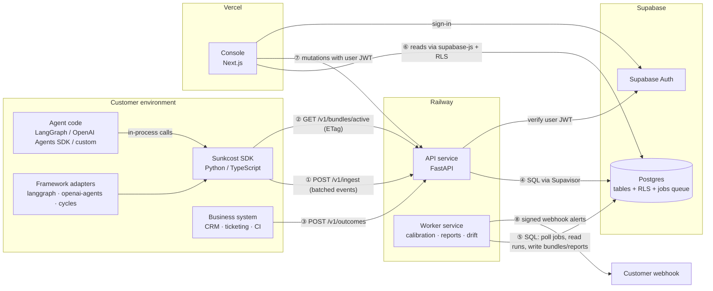
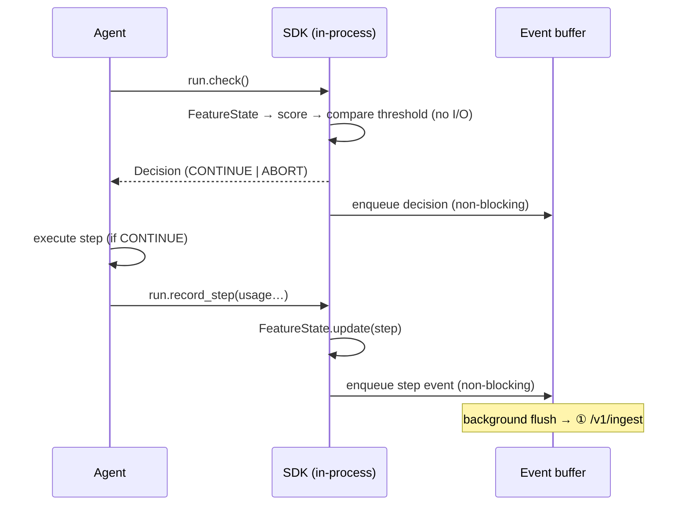
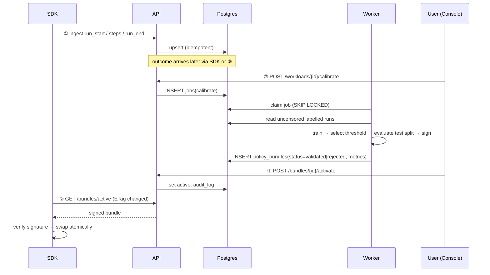
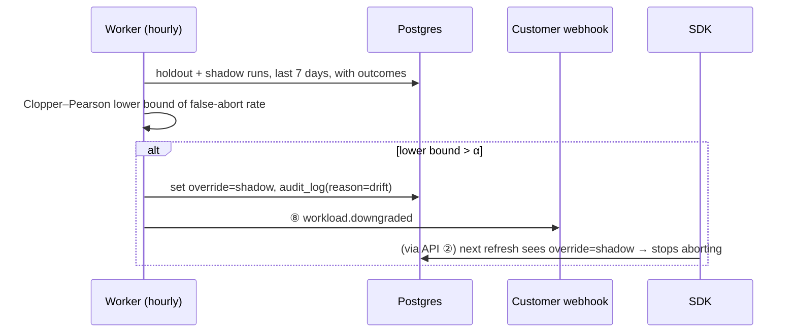

# Sunkcost — Architecture v1.0

Status: approved for implementation · Owner: Ronald Maduna · License: Apache-2.0

This document is the source of truth. Code that disagrees with it is a bug, or the doc gets an ADR in `docs/adr/` first.

---

## 1. Goal

**Stop AI agent runs that are going to fail, before they spend the rest of their budget, while provably keeping a target share of the runs that would have succeeded.**

A team installs the SDK, runs it in **shadow mode** against real traffic, and receives a **verified savings report**:

> "Last 14 days: 1,240 runs. Sunkcost would have aborted 212 of the 301 runs that ended in failure, saving $4,810 of spend that was measured, not estimated. It would also have aborted 9 of 939 runs that succeeded (0.96%, target ≤ 5%)."

When the numbers hold, the team switches the workload to **enforce mode**. A small holdout keeps measuring so the guarantee stays honest.

### 1.1 Success criteria for v1

| # | Criterion | Measured by |
|---|---|---|
| S1 | On ≥ 2 public agent-trajectory datasets, the calibrated policy keeps ≥ 90% of successful runs and saves > 0% of failed-run spend on the held-out test split | `bench/` report (release gate G1) |
| S2 | A `check()` decision adds < 0.5 ms p99 to an agent step and never makes a network call | SDK benchmark test (G3) |
| S3 | Loss of the Sunkcost cloud never stops, slows or errors a customer's agent | Failure tests (G4) |
| S4 | A tenant can never read or write another tenant's data | pgTAP RLS tests + API isolation tests (G5) |
| S5 | Shadow-mode savings in reports are computed only from observed spend | Report unit tests + e2e (G6) |
| S6 | A self-hoster can run the whole stack from the README in < 30 minutes | Docs check (G8) |

### 1.2 Non-goals for v1

The following are out of scope for v1:

- Budget reservation or spend caps. Cycles, LiteLLM and gateways already do this; Sunkcost integrates with them.
- Provider gateway or proxy.
- Prompt or completion capture.
- Semantic or LLM-judge signals, including Jev. The `features.v2` slot is reserved.
- Hidden-state or activation probes. Customers using API models don't have activations.
- Multi-currency. Everything is USD.
- Billing or payments for the hosted service.
- Deciding what a customer does after an abort (fallback, human handoff). The SDK reports the abort; the agent's code decides.

---

## 2. Concepts

| Term | Meaning |
|---|---|
| **Workload** | A class of agent task with its own policy (e.g. `support.billing_dispute`). Calibration is per workload. |
| **Run** | One execution of an agent on one task. Identified by a client-generated UUIDv7 `run_id`. |
| **Step** | One model call or tool call inside a run. Numbered `seq = 1, 2, 3…` |
| **Check** | The SDK call made *before* each step. It returns `CONTINUE` or `ABORT`. |
| **Outcome** | The business result of a run: `success`, `failure` or `abandoned`. It may arrive hours after the run ends, from a different system. |
| **Policy bundle** | A small signed JSON document (model weights, threshold, mode) that the SDK evaluates locally. |
| **Mode** | `shadow`: compute decisions but never abort. `enforce`: abort when the policy says so, except holdout runs. |
| **Holdout** | In enforce mode, a deterministic fraction of runs (default 5%) that are never aborted. They keep producing uncensored data and live monitoring. |
| **Target recall** | The minimum share of would-be-successful runs that must *not* be aborted, e.g. 0.95. `α = 1 − target_recall` is the tolerated false-abort rate. |
| **Verified saving** | Spend that a shadow or holdout run incurred *after* the step where Sunkcost would have aborted, on a run whose outcome was `failure`. It is observed, not modelled. |
| **Estimated saving** | For runs actually aborted in enforce mode, the counterfactual remaining spend is unknowable, so it is modelled from the test split. Always labelled "estimated" and never summed with verified savings. |

---

## 3. System overview



### 3.1 Components

| ID | Component | Runs on | Language | Owns | Talks to |
|---|---|---|---|---|---|
| C1 | **spec** (`packages/spec`) | build time only | JSON Schema + JSON fixtures | Wire contracts, feature spec, golden test vectors, price table | Consumed by every other component |
| C2 | **Python SDK** (`packages/sdk-python`, PyPI `sunkcost`) | customer process | Python ≥ 3.10 | Local decisions, feature extraction, event buffering, bundle verification | Agent code (in-process), API (①②) |
| C3 | **TypeScript SDK** (`packages/sdk-typescript`, npm `sunkcost`) | customer process | TypeScript, Node ≥ 20 and edge runtimes | Same as C2 | Same as C2 |
| C4 | **Adapters** (`adapters/*`) | customer process | Python | Mapping framework callbacks to `check` / `record_step` | Framework, C2 |
| C5 | **Core** (`packages/sdk-python/sunkcost/core`) | customer process + worker | pure Python, no third-party deps | Feature extraction v1, scoring, canonical JSON. The single Python implementation shared by SDK and worker | — |
| C6 | **API** (`services/api`) | Railway | Python 3.12, FastAPI, psycopg 3 | Authentication, ingestion, outcome intake, bundle serving, management endpoints, job enqueueing | SDK, business systems, console, Postgres |
| C7 | **Worker** (`services/worker`) | Railway | Python 3.12, numpy, scikit-learn, scipy | Calibration, bundle signing, reports, drift monitoring, retention, webhooks | Postgres, customer webhooks |
| C8 | **Database** (`supabase/`) | Supabase | Postgres 17 + SQL migrations + pgTAP | All durable state, the job queue, row-level security | API, worker, console |
| C9 | **Console** (`apps/console`) | Vercel | Next.js (App Router), TypeScript | Human UI: workloads, reports, bundles, keys, mode switches | Supabase (read), API (write), Supabase Auth |
| C10 | **Bench** (`bench/`) | CI + developer machine | Python | Reproducible evaluation on public trajectory datasets | C5, C7 libraries |

**Hard boundaries:**

1. The SDK makes **no network call inside `check()`**.
2. The console **never writes** to Postgres. Every mutation goes through the API, so there is exactly one write and audit path.
3. The API and worker **never call each other**. They communicate only through Postgres (the `jobs` table).
4. Only the worker holds the bundle **signing key**.
5. No component ever receives **prompt or completion text**.

---

## 4. Components in detail

### C1 · spec

The contracts every other component implements.

```
packages/spec/
  schemas/
    ingest-batch.v1.json       # envelope + run_start | step | run_end | outcome events
    outcome.v1.json
    bundle.v1.json             # signed payload
    bundle-response.v1.json    # {bundle, signature, key_id, override?}
    decision.v1.json
  features/
    features.v1.md             # normative definition (§7.1)
  vectors/
    features.v1/*.json         # step sequences → expected feature vectors and scores
    canonical-json/*.json      # object → canonical bytes (hex) → Ed25519 signature
  prices/
    prices.v1.json             # effective-dated USD per 1M tokens, with source URL and retrieved date
```

- Every schema has `$id` and `schema_version`.
- Python (Pydantic v2) and TypeScript types must round-trip every fixture. A conformance test in each package enforces this.
- The price table is filled from official provider pricing pages, each entry with `source_url` and `retrieved_at`. Callers may always pass `cost_usd` directly, which overrides the table.

### C2/C3 · SDKs

Public API (Python shown; TypeScript mirrors it in camelCase):

```python
sl = Sunkcost(
    api_key="sc_live_…",               # env SUNKCOST_API_KEY
    endpoint="https://api.sunkcost…",  # env SUNKCOST_ENDPOINT
    trusted_keys={"sc-2026-01": "<ed25519 pubkey b64>"},  # pinned; defaults ship in the package
    args_hash_salt="…",                # env SUNKCOST_ARGS_SALT; never sent to the server
)

run = sl.start_run(workload="support.billing_dispute",
                   run_id=None,          # UUIDv7 generated if absent
                   external_ref=None)    # e.g. ticket ID, used to attach late outcomes

d = run.check()          # before each step -> Decision
if d.action == "ABORT":
    ...                  # the agent's code decides what an abort means

run.record_step(kind="model", model="…", input_tokens=812, output_tokens=240,
                cost_usd=None,           # computed from the price table if None
                tool_name=None, tool_args=None,  # args are HMAC-hashed locally, never sent
                error=False, latency_ms=930)

run.end(status="completed")              # completed | aborted | errored
run.outcome("success", source="zendesk") # optional here; can also arrive via API later
```

`Decision` = `{action, mode, score, threshold, bundle_id, bundle_version, would_abort, reason}`.

`reason` is one of:
`no_bundle`, `bundle_expired`, `below_min_steps`, `below_threshold`, `above_threshold`, `holdout`, `shadow_mode`, `override_shadow`, `sdk_error`.

Internals:

- **Bundle manager**
  - Fetches the bundle at start-up, then refreshes every 300 s using `If-None-Match` (`GET /v1/bundles/active?workload=<name>`). A 404 means no active bundle and clears the cached one, which can only reduce enforcement (ADR-0004).
  - Verifies the Ed25519 signature against `trusted_keys` over the canonical bytes.
  - Rejects a bundle if the signature is bad, it has expired, `workload` doesn't match, or `version` is lower than the cached version.
  - May cache to disk (`SUNKCOST_CACHE_DIR`), together with the version floor used for rollback protection.
  - With no API key or endpoint, the SDK runs offline: decisions only, events discarded (ADR-0004).
- **Decision engine**
  - Pure function: `(bundle, run_prefix) → Decision`, running in O(steps). The order in which the reasons apply is fixed in ADR-0004.
  - Feature state is maintained incrementally, so each check is O(1) amortised.
- **Event buffer**
  - Bounded in-memory queue (default 10,000 events).
  - A background thread (Python) or timer (TS) flushes every 2 s or at 500 events.
  - On overflow it drops the oldest events and increments `dropped_events`.
  - Retries use exponential backoff with jitter, capped at 60 s.
  - Flush on `close()` and at process exit, with a bounded 3 s wait.
- **Fail-open**
  - Any exception inside the SDK returns `CONTINUE` with reason `sdk_error` and is counted.
  - The SDK never raises into agent code unless the adapter is configured with `raise_on_abort=True`.
- **Holdout assignment**
  - `holdout = (sha256(run_id)[:8] as uint32) mod 10_000 < holdout_rate × 10_000`, where `[:8]` is the first 8 hex digits of the SHA-256 of the lower-case `run_id` string (ADR-0002).
  - Deterministic and identical in both SDKs.
- **Dependencies**
  - Python: `httpx`, `cryptography`.
  - TypeScript: `@noble/ed25519` only; uses the platform `fetch` (Node.js 22+; ADR-0008 records the port's decisions).

### C4 · Adapters (Python, v1)

| Adapter | Hook | On ABORT |
|---|---|---|
| `sunkcost-langgraph` | LangChain callback handler (`raise_error=True`): `on_chat_model_start`/`on_llm_start` and `on_tool_start` before each model and tool invocation | Raises `RunAborted`; a node `error_handler` (LangGraph ≥ 1.2) handles it |
| `sunkcost-openai-agents` | Agents SDK run hooks (`on_llm_start`, `on_tool_start`; `on_llm_end` with usage, `on_tool_end`) | Raises `RunAborted` from the hook; `run_agent` unwraps the SDK's `UserError` around tool hooks |
| `sunkcost-cycles` | Wraps the Cycles (`runcycles`) lifecycle: a `guard` decorator above `@cycles`, or `reserve`/`commit` helpers, runs `check()` before the reservation. On ABORT, no reservation is made (ADR-0004). | Raises `RunAborted`; no Cycles reservation is created |

Each adapter ships an example in `examples/` that runs with a fake LLM, so it works without an API key.

The exact hook points must be confirmed against each framework's current documentation. If a hook doesn't exist, write an ADR and pick the nearest equivalent.

### C5 · Core

A pure-Python module in the SDK package, imported by both the SDK and the worker, so features are computed by the same code at training time and at decision time.

- `features_v1(prefix) -> list[float]`, incremental form `FeatureState.update(step)`
- `score_logistic_v1(bundle.model, x) -> float`
- `canonical_json(obj) -> bytes` (RFC 8785 subset: objects, arrays, strings, integers, booleans, null — **no floats**). Argument hashing uses full RFC 8785, floats included (ADR-0002).
- `holdout_bucket(run_id) -> int`

### C6 · API service

- **Stack:** FastAPI + Uvicorn, psycopg 3 async pool.
- **Database connection:** Supabase transaction pooler (port 6543) with **prepared statements disabled**.
- **Endpoints:**

| Method & path | Auth | Purpose |
|---|---|---|
| `POST /v1/ingest` | API key, scope `ingest` | Batch of ≤ 1,000 events, ≤ 1 MB. Validated against `ingest-batch.v1`. Idempotent (§8). Returns `{accepted, duplicates, rejected[]}` |
| `POST /v1/outcomes` | API key, scope `outcome:write` | One outcome by `run_id` or `(workload, external_ref)`. First final outcome wins; conflicts recorded |
| `GET /v1/bundles/active?workload=…` | API key, scope `bundle:read` | Returns `bundle-response.v1`. `ETag` = bundle id + signature + override state, so a re-signed bundle is new (ADR-0005). `304` when unchanged |
| `GET /v1/signing-keys` | public | Current and previous public keys |
| `GET /healthz`, `GET /readyz` | public | Liveness; readiness also pings the DB |
| `POST /v1/orgs`, `POST /v1/projects` | user JWT | Create organisation or project; the caller becomes owner |
| `POST /v1/api-keys`, `DELETE /v1/api-keys/{id}` | user JWT, role ≥ admin | Create (secret shown once) or revoke a key |
| `POST /v1/workloads`, `PATCH /v1/workloads/{id}` | user JWT, role ≥ admin | Create a workload or change its settings (target recall, δ, min steps, holdout rate, mode). A mode change enqueues a `resign_bundle` job |
| `POST /v1/workloads/{id}/calibrate` | user JWT, role ≥ member | Enqueue a calibration job |
| `POST /v1/bundles/{id}/activate` | user JWT, role ≥ admin | Promote a `validated` bundle to `active` |
| `POST /v1/workloads/{id}/override` | user JWT, role ≥ member | Emergency `shadow` override: immediate, unsigned, can only reduce enforcement |
| `PUT /v1/orgs/webhook` | user JWT, role ≥ admin | Set the webhook URL; returns a new signing secret once, stored in Supabase Vault (ADR-0006) |

- **Errors:** RFC 9457 problem+json. Every response carries `x-request-id`.
- **Console requests** name their organisation in an `x-sunkcost-org` header; workloads are also created on first use by `run_start` (ADR-0005).
- **Rate limits:** a token bucket per API key, held in memory per instance (documented limitation).
- **Operations:** structured JSON logs and Prometheus `/metrics`.

### C7 · Worker service

A single process with two loops:

1. **Job runner**
   - Claims jobs with `SELECT … FOR UPDATE SKIP LOCKED` from `jobs`.
   - Job types: `calibrate`, `resign_bundle`, `build_report`.
   - Each job has at most 3 attempts with backoff, then `dead`.
   - Job timeout: 15 minutes.
2. **Scheduler**
   - Holds a Postgres advisory lock so only one worker schedules, even if scaled out.
   - Enqueues on a schedule:
     - Daily reports per workload, plus a trailing-week report (ADR-0007).
     - Drift check every hour.
     - Retention purge daily.
     - Nightly recalibration for workloads with ≥ 200 new labelled runs.

The worker holds `BUNDLE_SIGNING_KEY` and sends HMAC-SHA256-signed webhooks to per-org URLs. Job claiming, scheduler deduplication, calibration input, re-signing, drift and webhook delivery details are in ADR-0006.

### C8 · Database

Supabase Postgres, migrations in `supabase/migrations/` (Supabase CLI), RLS tests in `supabase/tests/` (pgTAP). Schema in §8.

### C9 · Console

Next.js on Vercel. Server components read through `@supabase/ssr` as the signed-in user, with RLS doing the scoping. Server actions call the API with the user's access token.

Pages:

1. Sign-in (magic link; GitHub OAuth optional)
2. Organisation and projects
3. API keys
4. Workloads list: mode, active bundle, last-7-day verified savings, false-abort rate with CI
5. Workload detail:
   - Savings report chart (verified vs estimated, never stacked together)
   - Successes lost
   - Bundle history with metrics
   - Calibrate button
   - Mode switch
   - Emergency override
6. Run explorer: per-run step timeline showing score against threshold, and the would-abort point
7. Audit log

The **enforce toggle is disabled** until the workload has at least one `validated` bundle *and* one shadow report covering ≥ 7 days. ADR-0007 defines both terms precisely and records the console's other decisions (sign-in, decimal money, scope).

### C10 · Bench

- `bench/datasets/`: loaders for public agent-trajectory datasets that have per-run success labels.
  - Candidate sources: the SWE-bench `experiments` trajectories, and the public datasets listed in arXiv 2608.23670.
  - Claude Code must verify each licence and record provenance in `bench/DATASETS.md`.
  - If a dataset lacks cost, cost = tokens × `prices.v1` for the recorded model; if tokens are also missing, step count is the cost proxy. State this in the report.
- `bench/run.py`: loads data, applies the exact worker calibration code, writes `bench/results/<dataset>.json` and the curve plot "share of failed-run spend saved" against "successful runs lost" at target recall 0.90 and 0.95.

---

## 5. How components communicate

### 5.1 Interface table

| # | From → To | Transport | Auth | Sync? | Payload | Failure behaviour |
|---|---|---|---|---|---|---|
| ① | SDK → API `/v1/ingest` | HTTPS POST, JSON, gzip allowed | `Authorization: Bearer sc_live_…` (scope `ingest`) | Async (background flush) | `ingest-batch.v1` | Retry with backoff; bounded buffer drops oldest; agent unaffected |
| ② | SDK → API `/v1/bundles/active?workload=` | HTTPS GET, `If-None-Match` | API key (scope `bundle:read`) | Async (background refresh) | `bundle-response.v1` | Keep cached bundle until `expires_at`; after that, no aborts (`bundle_expired`) |
| ③ | Business system → API `/v1/outcomes` | HTTPS POST | API key (scope `outcome:write`) | Sync | `outcome.v1` | Client retries; server idempotent |
| ④ | API → Postgres | TLS via Supavisor transaction pooler | DB role `sunkcost_api`; `SET LOCAL app.org_id` per transaction | Sync | SQL | 503 with `Retry-After`; the SDK retries |
| ⑤ | Worker → Postgres | TLS, **session** pooler (port 5432) for advisory locks and long jobs | DB role `sunkcost_worker` | Sync | SQL | Job retried up to 3×, then `dead` and visible in the console |
| ⑥ | Console → Postgres | supabase-js over PostgREST | User JWT; RLS `SELECT`-only policies | Sync | Rows | Error state in the UI |
| ⑦ | Console → API | HTTPS | `Authorization: Bearer <supabase access token>`; API verifies against the Supabase JWT secret or JWKS, then checks membership | Sync | JSON | Error toast; no partial writes (one transaction per request) |
| ⑧ | Worker → customer webhook | HTTPS POST | `X-Sunkcost-Signature: t=…,v1=HMAC_SHA256(secret, t.body)`; the secret is kept in Supabase Vault (ADR-0006) | Async | `{type, workload_id, …}` | 5 attempts over 1 h, then logged as failed |
| — | API ↔ Worker | **via `jobs` table only** | — | Async | `{type, payload}` | — |

### 5.2 Hot path: one agent step



### 5.3 From data to an active policy



### 5.4 Drift auto-downgrade



---

## 6. Contracts (abridged; full JSON Schemas live in `packages/spec`)

### 6.1 Ingest batch

```json
{
  "schema_version": "1",
  "sent_at": "2026-09-23T10:00:00Z",
  "sdk": {"name": "sunkcost-python", "version": "0.1.0"},
  "dropped_events": 0,
  "events": [
    {"type": "run_start", "run_id": "0192…", "workload": "support.billing_dispute",
     "external_ref": "ZD-8812", "started_at": "…", "bundle_id": "…", "bundle_version": 7,
     "mode": "shadow", "holdout": false},
    {"type": "step", "run_id": "0192…", "seq": 4, "ts": "…", "kind": "tool",
     "model": null, "tool_name": "search_kb", "args_hash": "hmac-sha256:9f…",
     "input_tokens": 0, "output_tokens": 0, "cost_usd": "0.002000", "error": false,
     "latency_ms": 310,
     "decision": {"action": "CONTINUE", "score": "0.4123", "threshold": "0.8421",
                  "would_abort": false, "reason": "below_threshold"}},
    {"type": "run_end", "run_id": "0192…", "ended_at": "…", "status": "completed",
     "total_cost_usd": "0.184000", "steps": 11, "would_abort_step": 5,
     "cost_through_would_abort_usd": "0.041000", "aborted_step": null},
    {"type": "outcome", "run_id": "0192…", "outcome": "success", "source": "sdk",
     "reported_at": "…"}
  ]
}
```

Rules:

- Money is a decimal string with ≤ 9 fractional digits, stored as `numeric(20,9)`.
- Scores and thresholds are decimal strings in the wire format.
- Every event field is required; absent values are `null` (for example `cost_usd` when the price is unknown).
- `run_end` carries the run's decision summary (`would_abort_step`, `cost_through_would_abort_usd`, `aborted_step`), because an enforced `ABORT` means no later step event exists to carry it (ADR-0002).

### 6.2 Bundle and response

```json
{
  "schema_version": "1",
  "bundle": {
    "schema_version": "1",
    "bundle_id": "uuid", "org_id": "uuid", "project_id": "uuid",
    "workload_id": "uuid", "workload": "support.billing_dispute",
    "version": 7, "feature_spec": "features.v1",
    "mode": "enforce", "holdout_rate": "0.05",
    "model": {"type": "logistic_v1", "intercept": "-2.1302",
              "features": ["step_index", "log_cost", "…"],
              "weights": ["0.1204", "…"], "means": ["…"], "stds": ["…"]},
    "decision": {"threshold": "0.842106", "min_steps": 3,
                 "target_recall": "0.95", "delta": "0.05"},
    "metrics": {"n_train": 1840, "n_calib_success": 402, "test_false_abort_rate": "0.031",
                "test_savings_share": "0.274", "auroc": "0.81"},
    "issued_at": "…", "expires_at": "…"
  },
  "key_id": "sc-2026-01",
  "signature": "base64(ed25519(canonical_json(bundle)))",
  "override": null
}
```

- **No JSON floats in signed content.** Numbers that are not integers are decimal strings written with Python `repr(float)` (shortest round-trip form). Both SDKs parse them to IEEE-754 float64, so every implementation evaluates identical values.
- `override` is **unsigned** and may only be `null` or `"shadow"`. The SDK obeys `"shadow"` because it can only *reduce* enforcement. Anything that increases enforcement, such as a mode change to `enforce` or a new threshold, requires a newly signed bundle version.
- `expires_at` defaults to `issued_at + 7 days`. The worker re-signs active bundles daily.

---

## 7. Algorithms

### 7.1 Features v1 (normative)

Computed on the prefix of completed steps `1..k` at the moment `check()` is called. Let `a_i = (kind, tool_name or model, args_hash or "")` be the action of step `i`, and `s_i = (kind, tool_name or model)` its abstract state.

| Name | Definition |
|---|---|
| `step_index` | `k` |
| `log_cost` | `log1p(Σ cost_usd)` |
| `log_tokens` | `log1p(Σ (input_tokens + output_tokens))` |
| `recent_cost_share` | cost of steps `k-2..k` ÷ max(Σ cost, 1e-12); `0` if `k = 0` |
| `repeat_action_rate` | share of the last 5 steps whose `a_i` equals some earlier `a_j` (`j < i`) |
| `max_identical_streak` | longest run of consecutive identical `a_i` in the prefix |
| `error_rate` | errors ÷ max(k,1) |
| `error_streak` | consecutive errors ending at step `k` |
| `distinct_action_ratio` | distinct `a_i` ÷ max(k,1) |
| `cycle_rate` | for `i ≥ 2`, share of transitions `(s_{i-1}, s_i)` already seen earlier in the run; `0` if `k < 2` |
| `context_growth` | `log1p(input_tokens_last_model_step) − log1p(input_tokens_first_model_step)`, both within `1..k`; `0` if there is no model step |
| `log_elapsed_s` | `log1p(max(0, seconds from run_start to ts_k))`; `0` if `k = 0` |

- Arithmetic is float64 in the listed order. The complete definition, including edge cases and the exact order of operations, is `packages/spec/features/features.v1.md` (ADR-0002).
- Golden vectors in `packages/spec/vectors/features.v1/` are normative: the Python and TypeScript SDKs must match each vector within a relative tolerance of 1e-12.

### 7.2 Model

- L2-regularised logistic regression (scikit-learn, lbfgs). `C` is chosen from 10⁻⁴ … 10⁴ (9 values) by weighted log-loss under 5-fold CV on the train split, grouped by run (or task, when the data names one) so no run's prefixes straddle folds; ties go to the smaller `C` (ADR-0003).
- Features are standardised with the train rows' unweighted means and population standard deviations. A standard deviation of 0 is replaced by 1.
- **Decision points.** `check()` runs before each step, so a run of `n` steps has decision points `k = min_steps … n − 1` and none after its final step. Training rows are the decision points of every training run, labelled with the run's final outcome (1 = failure).
- Each row is weighted `1 / (number of rows of its run)`, so every run carries a total weight of 1 and long runs don't dominate.
- Score: `σ(intercept + Σ w_j (x_j − μ_j)/σ_j)`.

### 7.3 Threshold selection with a recall guarantee

**Data:**

- Only **uncensored** runs are used: shadow-mode runs and enforce-mode holdout runs with a final outcome of `success` or `failure`. Aborted runs are never used, since their counterfactual outcome is unknown.
- `abandoned` outcomes are excluded.
- Split **by time**: runs ordered by `(started_at, run_id)`; of `n` runs, the first ⌊3n/5⌋ train, up to ⌊4n/5⌋ calibration, the rest test (oldest 60%, next 20%, newest 20%).

**Minimums:** 100 successes and 30 failures in each of calibration and test. Otherwise the job ends `insufficient_data` with the counts.

**Procedure:**

1. For each calibration-split success `i`, compute `m_i`, the highest score it reached at any of its decision points (§7.2). A success with no decision points counts in `n` but can never be aborted.
2. For a candidate threshold `τ`, the false-abort count is `c(τ) = #{i : m_i ≥ τ}`, out of `n` successes.
3. `UCB(τ)` is the one-sided Clopper–Pearson upper bound at confidence `1 − δ`.
4. Choose the **smallest** `τ` among candidate values (the `m_i` plus 1.0) with `UCB(τ) ≤ α`. A smaller `τ` means earlier aborts and more savings. Scanning many candidates doesn't weaken the bound: `c(τ)` is monotone in `τ`, so this is fixed-sequence testing (scan from `τ = 1.0` downward and stop at the first candidate that fails).
5. If no candidate qualifies, the job ends `rejected: cannot_meet_recall`.

**Guarantee:** if future runs of the workload are exchangeable with the calibration runs, then with probability ≥ `1 − δ` the true false-abort rate is ≤ `α`.

This is a statistical guarantee under that assumption, not an absolute one. Drift monitoring (§7.5) exists because the assumption can break. Documentation and the console must state this plainly.

**Evaluation on the test split:**

- Realised false-abort rate, with a two-sided 95% Clopper–Pearson interval.
- `savings_share` = Σ over failures aborted at step `k` of (total cost − cost through step `k`) ÷ Σ total cost of all test runs.
- AUROC of the max-score per run (runs without decision points rank lowest).

**Validation gate:** a bundle becomes `validated` when all three hold:

- Test false-abort rate ≤ `α`
- `savings_share ≥ min_savings_share` (default 0.02)
- AUROC ≥ 0.6

Otherwise it becomes `rejected`, with the reason stored.

### 7.4 Savings accounting

| Run type | Would-abort step k? | Outcome | Contribution |
|---|---|---|---|
| shadow or holdout | yes | failure | `verified_saving += total_cost − cost_through_k` |
| shadow or holdout | yes | success | `successes_lost += 1` (reported with CI) |
| shadow or holdout | no | any | none |
| enforce, aborted | — | — | `estimated_saving += mean remaining cost of aborted failures in the bundle's test split` |

Reports store verified and estimated values in separate columns. The console shows them side by side, never summed.

### 7.5 Drift monitor

Runs hourly per enforce-mode workload:

- Over holdout runs from the last 7 days with outcomes, compute the Clopper–Pearson **lower** bound of the false-abort rate among successes.
- If it exceeds `α`:
  - Set `override = 'shadow'`
  - Write `audit_log(actor='system', reason='drift')`
  - Send the `workload.downgraded` webhook

Only a human can clear the override.

---

## 8. Data model (Supabase Postgres)

All tables have `org_id uuid not null`. Timestamps are `timestamptz`.

| Table | Key columns | Notes |
|---|---|---|
| `orgs` | `id, name, webhook_url, webhook_secret_hash` | `org_id` is a generated copy of `id` |
| `org_members` | `org_id, user_id → auth.users, role (owner/admin/member/viewer)` | PK `(org_id, user_id)` |
| `projects` | `id, org_id, name` | |
| `api_keys` | `id, org_id, project_id, prefix, secret_sha256, scopes text[], created_by, revoked_at, last_used_at` | Key format `sc_live_<prefix8>_<secret32>`; lookup by prefix, constant-time compare of the hash |
| `workloads` | `id, org_id, project_id, name, mode, override, target_recall, delta, min_steps, holdout_rate, min_savings_share` | Unique `(project_id, name)` |
| `runs` | PK `(org_id, id)` (`id` = run_id), `project_id, workload_id (null only while status = 'partial'), external_ref, started_at, ended_at, status, steps, total_cost_usd numeric(20,9), mode, holdout, bundle_id, would_abort_step, cost_through_would_abort numeric(20,9), aborted_step, outcome, outcome_source, outcome_at, outcome_conflict, received_at, run_month` | Index `(workload_id, outcome_at)`, `(workload_id, external_ref)`. `status` is derived: `partial`, `running`, or the `run_end` status (ADR-0005) |
| `step_events` | PK `(org_id, run_id, seq, run_month)`, `ts, kind, model, tool_name, args_hash, input_tokens, output_tokens, cost_usd numeric(20,9), error, latency_ms, score, threshold, would_abort` | Range-partitioned by `run_month`, the month the server first received the run, so re-sent steps deduplicate and retention follows the server clock (ADR-0005); 90-day retention |
| `policy_bundles` | `id, org_id, workload_id, version, status (validated/rejected/active/retired), payload jsonb, signature, key_id, metrics jsonb, reason, created_at` | Unique `(workload_id, version)`; at most one `active` per workload (partial unique index) |
| `reports` | `id, org_id, workload_id, period_start, period_end, runs, verified_saving_usd, estimated_saving_usd, failures_caught, successes_lost, false_abort_rate, fa_ci_low, fa_ci_high, enforced_runs, first_run_at` | Daily and trailing-week periods; the last two columns decide the console's enforce gate (ADR-0007) |
| `jobs` | `id, org_id, type, payload jsonb, status (queued/running/done/failed/dead), attempts, run_after, locked_at, error` | Claimed with `SKIP LOCKED` |
| `audit_log` | `id, org_id, actor (user id or 'system'), action, target, before jsonb, after jsonb, at` | Append-only; UPDATE and DELETE revoked from every role |

### 8.1 Access control

**`authenticated` role (console via PostgREST):**

- `SELECT` only, on rows where `org_id` is in the user's `org_members`.
- `api_keys.secret_sha256` and `orgs.webhook_secret_hash` are excluded by column grants.

**`sunkcost_api` and `sunkcost_worker` roles:**

- Login roles without `BYPASSRLS`.
- Every transaction runs `SET LOCAL app.org_id = …`, and RLS policies check `org_id = current_setting('app.org_id')::uuid`.
- API-key lookup and the scheduler's cross-org scan go through two narrow `SECURITY DEFINER` functions:
  - `resolve_api_key(prefix)`
  - `list_due_work()`
  - Plus `my_org_ids()` (the console's own memberships, for RLS) and `ensure_step_partitions()` (partition maintenance) (ADR-0005).
- These functions have a pinned `search_path` and are executable only by those roles.

**Other rules:**

- `anon` has no table access.
- The Supabase `service_role` key is **not used** by any Sunkcost component.

### 8.2 Idempotency

| Event | Rule |
|---|---|
| `run_start` | Upsert on `run_id`; first write wins for immutable fields |
| `step` | `INSERT … ON CONFLICT (run_id, seq) DO NOTHING`; counted as a duplicate |
| `run_end` | Upsert; `ended_at` set once |
| `outcome` | The first final outcome wins. A different later value sets `outcome_conflict = true` and writes an `audit_log` entry, but doesn't change the stored outcome |
| Events for an unknown `run_id` | `step`, `run_end` and `outcome` create a placeholder run (`status = 'partial'`); a later `run_start` fills it (ADR-0005) |

---

## 9. Security and privacy

- **No prompt or completion content.** Tool arguments leave the process only as `HMAC-SHA256(args_hash_salt, JCS(args))`, where JCS is RFC 8785 including its number serialization (ADR-0002). The salt never leaves the customer.
- **Transport:** TLS everywhere. The API sets HSTS and restricts CORS to the console origin, and only for JWT routes. Ingest routes reject browser `Origin` headers.
- **Secrets:** only in Railway, Vercel and Supabase environment settings. Never committed; gitleaks runs in CI.
- **Signing key:**
  - Ed25519, generated offline by the owner with `scripts/gen-signing-key.py`.
  - The private key exists only in the worker's environment.
  - Public keys are published at `/v1/signing-keys` and pinned in both SDKs by `key_id`.
  - **Rotation:** add the new key to SDK defaults → release the SDKs → switch the worker → keep the old key trusted for 30 days.
- **Input limits:**
  - Requests ≤ 1 MB, ≤ 1,000 events per batch.
  - String fields ≤ 256 characters; `external_ref` ≤ 128 characters.
  - Numbers are range-checked.
- **Abuse:** per-key rate limit; revoked keys are rejected on the next request.
- **Supply chain:**
  - Lockfiles committed.
  - Dependabot enabled.
  - `pip-audit`, `pnpm audit`, Semgrep, CodeQL and Trivy run in CI.
  - GitHub Actions pinned by SHA.
  - Packages published via PyPI and npm **trusted publishing** from tags only.
- **Threats and their controls:**

| Threat | Control |
|---|---|
| Forged or tampered bundle | Signature check |
| Rollback to an old bundle | Version must be ≥ cached version, plus `expires_at` |
| Man-in-the-middle forcing enforcement | Impossible, because only signed bundles raise enforcement |
| Cross-tenant read | RLS + pgTAP tests |
| Key leak | Revoke button; `last_used_at` visible in the console |

---

## 10. Failure behaviour

| Failure | Effect on the customer's agent | System behaviour |
|---|---|---|
| API unreachable | None | SDK buffers events and keeps its cached bundle; aborts continue until `expires_at`, then stop |
| No bundle yet | None (`CONTINUE`, `no_bundle`) | Events still flow, so data accumulates for the first calibration |
| Bundle signature invalid | None (keeps previous bundle or `no_bundle`) | Counter plus a warning log |
| SDK internal exception | None (`CONTINUE`, `sdk_error`) | Counter |
| Event buffer full | None | Oldest dropped; `dropped_events` reported in the next batch header |
| Postgres down | None | API returns 503; SDK retries; worker jobs retry |
| Worker down | None | Calibrations and reports queue up; active bundles still served until expiry. An alert fires if no bundle has been re-signed in 36 h |
| Outcome never arrives | None | Run is excluded from calibration and reports; the console shows "outcome pending" counts |
| Drift detected | Aborts stop within one bundle-refresh interval (≤ 5 min) | Override set, webhook and audit entry |
| Clock skew on the client | None | Server uses `received_at` for partitioning and retention; client timestamps are used only for ordering within a run |

---

## 11. Deployment

### 11.1 Environments

| | Local | Staging | Production |
|---|---|---|---|
| Database + Auth | `supabase start` (Supabase CLI, Docker) | Supabase project `sunkcost-staging` | Supabase project `sunkcost-prod` |
| API + Worker | `docker compose up` | Railway environment `staging` | Railway environment `production` |
| Console | `pnpm dev` | Vercel Preview (branch `main`) | Vercel Production (tags `v*`) |
| Signing key | Test key from `scripts/` (never valid in prod) | Staging key | Production key (owner-generated) |

### 11.2 Railway

- Two services from one repo, both built from Dockerfiles: `services/api/Dockerfile` and `services/worker/Dockerfile`.
- Health checks: `/readyz` for the API; the worker exposes `/healthz` on an internal port. Both listen on Railway's `$PORT`, and deploys run from GitHub Actions after migrations (ADR-0009).
- **Migrations never run in Railway pre-deploy.**
  - Migrations are applied by a GitHub Actions workflow with `supabase db push`.
  - Staging runs on merge to `main`.
  - Production requires manual approval and a completed dry run.
  - Every migration must be backward compatible with the previously deployed code (expand → deploy → contract).

### 11.3 Configuration

| Service | Variable | Notes |
|---|---|---|
| api | `DATABASE_URL` | Supavisor transaction pooler, role `sunkcost_api` |
| api | `SUPABASE_URL`, `SUPABASE_JWT_SECRET` or `SUPABASE_JWKS_URL` | User token verification |
| api | `CONSOLE_ORIGIN` | CORS |
| api | `LOG_LEVEL`, `RATE_LIMIT_PER_MIN` | |
| worker | `DATABASE_URL` | Session pooler, role `sunkcost_worker` |
| worker | `BUNDLE_SIGNING_KEY`, `BUNDLE_SIGNING_KEY_ID` | Base64 Ed25519 seed |
| worker | `WEBHOOK_TIMEOUT_S`, `POLL_INTERVAL_S`, `SCHEDULE_INTERVAL_S`, `DRIFT_INTERVAL_S` | Defaults 10, 2, 60, 3600 s; staging shortens the last two for G7 (ADR-0009) |
| console | `NEXT_PUBLIC_SUPABASE_URL`, `NEXT_PUBLIC_SUPABASE_ANON_KEY`, `NEXT_PUBLIC_API_URL` | |

The full list, with the GitHub environments and registry settings, is in `docs/DEPLOYMENT.md`.

### 11.4 Release flow

Implemented by `.github/workflows/staging.yml` and `release.yml` (ADR-0009).

```
PR ──► CI (all gates except G7) ──► merge to main
   ──► migrations to staging ──► Railway staging + Vercel preview deploy
   ──► staging smoke + e2e (G7) ──► RELEASE_REPORT.md
   ──► owner approves GitHub Environment "production"
   ──► tag v* ──► prod migrations (after dry run) ──► Railway prod + Vercel prod
   ──► prod smoke (read-only + synthetic workload in a dedicated org)
   ──► packages published (PyPI, npm) from the tag
```

---

## 12. Repository layout

```
sunkcost/
├── CLAUDE.md                     # rules for Claude Code
├── README.md                     # quickstart, self-hosting, links
├── LICENSE                       # Apache-2.0
├── Makefile                      # single entry point for every gate
├── docker-compose.yml            # api + worker against local Supabase
├── docs/
│   ├── ARCHITECTURE.md           # this file
│   ├── adr/                      # 0001-*.md …
│   ├── BENCHMARKS.md             # generated from bench/results
│   ├── SELF_HOSTING.md
│   └── PERF.md                   # measured, not claimed
├── packages/
│   ├── spec/
│   ├── sdk-python/               # includes sunkcost/core (C5)
│   └── sdk-typescript/
├── adapters/
│   ├── langgraph/
│   ├── openai-agents/
│   └── cycles/
├── services/
│   ├── api/
│   └── worker/
├── apps/
│   └── console/
├── supabase/
│   ├── config.toml
│   ├── migrations/
│   ├── seed.sql
│   └── tests/                    # pgTAP
├── bench/
├── examples/                     # runnable with a fake LLM, no keys
├── scripts/                      # gen-signing-key, smoke-staging, load-test
└── .github/workflows/
```

Tooling: `uv` workspace for Python, `pnpm` workspace for TypeScript, Ruff + mypy (strict on `core`, the SDK and the API), ESLint + `tsc --noEmit`, pytest, Vitest, Playwright (console e2e).

---

## 13. Testing and release gates

Claude Code must run every gate and record the results in `RELEASE_REPORT.md`. A gate that can't run in the current environment (e.g. no Docker) is reported as **NOT RUN**, never as passed.

| Gate | Command | Pass criteria |
|---|---|---|
| **G0 Static** | `make lint typecheck` | Zero errors |
| **G1 Proof** | `make bench` | S1 met on ≥ 2 datasets; `docs/BENCHMARKS.md` regenerated |
| **G2 Unit** | `make test-unit` | All pass. Includes: features against golden vectors (both SDKs); canonical JSON and signatures against vectors; Clopper–Pearson against scipy reference values; threshold selection edge cases (all-equal scores, n below minimum, no feasible τ); savings accounting table §7.4 |
| **G2b Statistical** | `make test-stats` | 500 simulated workloads with known failure processes: the share of simulations whose realised future false-abort rate exceeds α is ≤ δ + 0.03. Fixed seeds |
| **G3 SDK perf** | `make bench-sdk` | `check()` p99 < 0.5 ms at step 200, Python and Node, results written to `docs/PERF.md` |
| **G4 Failure** | `make test-failure` | API down, slow (10 s), 500s, bad signature, expired bundle, rollback attempt, buffer overflow, process exit mid-flush, `sdk_error` injection: agent completes every time and decisions match §10 |
| **G5 Isolation** | `make test-db` | `supabase db reset` + pgTAP: tenant A can't read tenant B through PostgREST, API roles or definer functions; `audit_log` immutable; console role can't write |
| **G6 Integration** | `make test-integration` | API + worker + local Supabase: ingest idempotency (duplicate batches), late outcome, outcome conflict, placeholder runs, calibration on synthetic data → validated bundle → SDK picks it up → enforce with holdout → report numbers equal hand-computed expectations |
| **G6b Console e2e** | `make test-e2e` | Playwright: sign-in, create workload, create key, calibrate, activate, enforce toggle disabled until the conditions in §4 C9 are met, override |
| **G7 Staging** | `make smoke-staging` | Against the deployed staging stack: health, ingest, outcome, bundle fetch and verification, one full calibration cycle on synthetic data, drift downgrade triggered and observed by the SDK |
| **G8 Security + docs** | `make security docs-check` | gitleaks, Semgrep, pip-audit, pnpm audit, Trivy clean or with written waivers; README quickstart executed end to end in a clean container |
| **Load** | `make load-test` (staging) | Sustained ingest for 10 min at the target rate; result recorded in `docs/PERF.md` whether or not it meets the 1,000 events/s target |

**Production promotion is a human action.** Claude Code prepares the release, runs G0–G8 and staging, writes `RELEASE_REPORT.md`, and stops.

---

## 14. Build phases

Each phase ends with its gates green and a short entry in `docs/PROGRESS.md`.

| Phase | Scope | Exit gates | Stop for owner? |
|---|---|---|---|
| P0 | Monorepo scaffold, tooling, CI skeleton, `packages/spec` schemas and vectors, ADR-0001 (this architecture) | G0 | No |
| P1 | Core (features, scoring, canonical JSON), worker calibration library (as a library, no service yet), `bench/` on public datasets | G0, G1, G2, G2b | **Yes: review the benchmark results.** Kill or continue decision |
| P2 | Python SDK (bundle manager, decision engine, buffer, transport), adapters, examples | G2, G3 (Python), G4 | No |
| P3 | Supabase schema, RLS, definer functions, pgTAP; API service | G5, G6 (API parts) | No |
| P4 | Worker service (jobs, scheduler, calibrate, re-sign, reports, drift, retention, webhooks) | G6 | No |
| P5 | Console | G6b | No |
| P6 | TypeScript SDK (vectors, perf, failure tests) | G2, G3 (Node), G4 | No |
| P7 | Staging deployment wiring, smoke script, load test, security gates, docs, `RELEASE_REPORT.md` | G7, G8, Load | **Yes: approval for production** |

---

## 15. Decisions log (defaults chosen)

| Decision | Choice | Why |
|---|---|---|
| Name | Sunkcost | Names the failure mode it fixes: agents keep spending on a run because of what they've already spent. Deliberately not a budget-cap name (that's Cycles' and the gateways' job). Free on PyPI and npm as of 23 Sep 2026; trademark not checked |
| License | Apache-2.0, whole repo | Revenue comes from the hosted service. Switching to open-core later requires an ADR |
| Model | Logistic regression | Portable to both SDKs as numbers, fast, auditable; stronger models later via `logistic_v1` → `*_v2` |
| Queue | Postgres `jobs` table | No extra infrastructure; testable locally |
| Bundles in Postgres | `jsonb`, < 20 KB each | No Storage bucket needed |
| Enforcement raise | Signed bundles only | MITM or API compromise can't cause aborts |
| Emergency downgrade | Unsigned `override: shadow` | Must be instant, and can only reduce enforcement |
