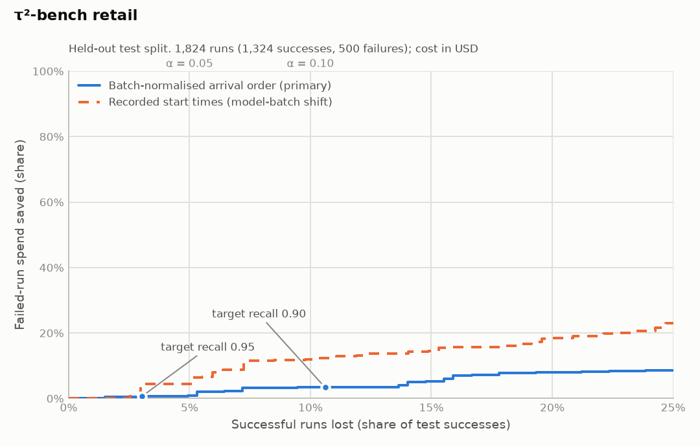
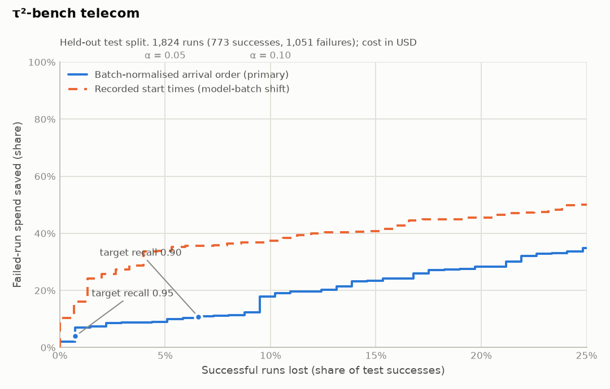
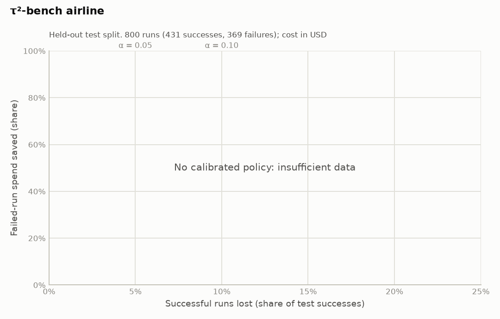
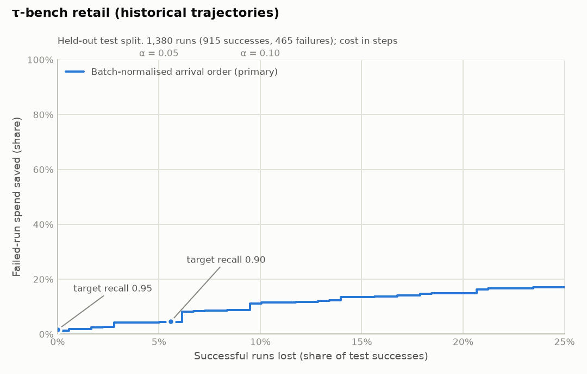
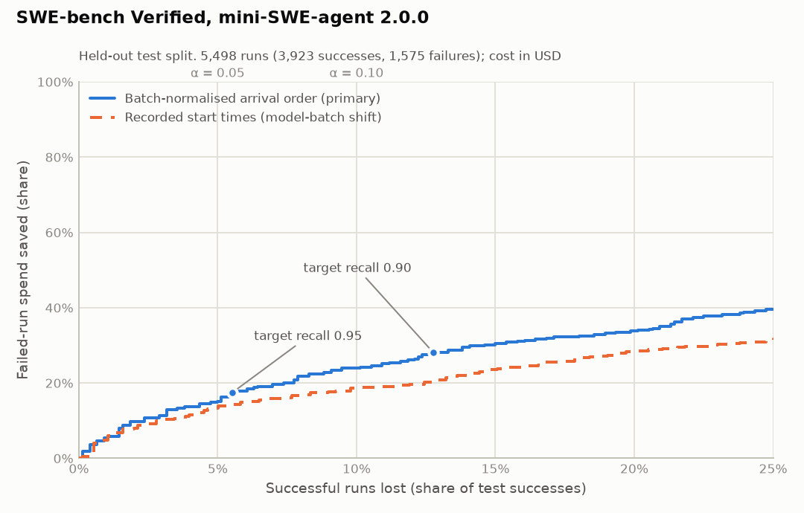

# Benchmarks

Generated by `make bench` (`bench/run.py`) on 2026-09-23 from commit `1217d74`. Do not edit by hand.

Every number comes from the held-out **test split** (the newest 20% of runs), after
the exact worker calibration code trains on the oldest 60% and picks the threshold on
the next 20% (ARCHITECTURE.md §7.2–§7.3, ADR-0003). Settings are the workload defaults
for every dataset, with no tuning: δ = 0.05, min_steps = 3,
min_savings_share = 0.02. Target recall 0.90 means α = 0.10.

## Success criterion S1

S1 requires, on at least 2 public datasets, that the calibrated policy keep ≥ 90% of
successful runs and save more than 0% of failed-run spend on the test split (target
recall 0.90).

**S1 is met: 2 of 5 datasets pass.**

Without SWE-bench Verified, mini-SWE-agent 2.0.0, whose licence the owner has not yet confirmed
(`bench/DATASETS.md`), S1 is met: 2 of 4 datasets pass.

| Dataset | S1 | Detail |
|---|---|---|
| τ²-bench retail | fail | kept 89.4% of test successes (>= 90% required), saved 3.4% of failed-run spend (> 0% required) |
| τ²-bench telecom | pass | kept 93.4% of test successes (>= 90% required), saved 10.8% of failed-run spend (> 0% required) |
| τ²-bench airline | fail | no calibrated policy (insufficient_data: calibration has 85 successes; test has 76 successes (need >= 100 successes and >= 30 failures in each)) |
| τ-bench retail (historical trajectories) | pass | kept 94.4% of test successes (>= 90% required), saved 4.6% of failed-run spend (> 0% required) |
| SWE-bench Verified, mini-SWE-agent 2.0.0 | fail | kept 87.2% of test successes (>= 90% required), saved 28.1% of failed-run spend (> 0% required) |

## Results (primary protocol)

Primary protocol: batch-normalised arrival order (see below). “Failed-run spend
saved” is spend after the abort point on runs that ended in failure, divided by all
failed-run spend. “All spend saved” divides the same amount by all test spend (the
`savings_share` of §7.3). Spend on successes cut short is never counted as a saving.

| Dataset | Target recall | Status | τ | Successful runs lost (test) | Failed-run spend saved | All spend saved | AUROC |
|---|---|---|---|---|---|---|---|
| τ²-bench retail | 0.90 | rejected (test_false_abort_rate_above_alpha,savings_share_below_minimum,auroc_below_minimum) | 0.5110 | 10.6% (28/264; 95% CI 7.2%–15.0%) | 3.4% | 0.9% | 0.542 |
| τ²-bench retail | 0.95 | rejected (savings_share_below_minimum,auroc_below_minimum) | 0.5609 | 3.0% (8/264; 95% CI 1.3%–5.9%) | 0.6% | 0.2% | 0.542 |
| τ²-bench telecom | 0.90 | validated | 0.8571 | 6.6% (9/137; 95% CI 3.0%–12.1%) | 10.8% | 6.9% | 0.784 |
| τ²-bench telecom | 0.95 | validated | 0.9351 | 0.7% (1/137; 95% CI 0.0%–4.0%) | 3.9% | 2.5% | 0.784 |
| τ²-bench airline | 0.90 | insufficient_data (calibration has 85 successes; test has 76 successes (need >= 100 successes and >= 30 failures in each)) | – | – | – | – | – |
| τ²-bench airline | 0.95 | insufficient_data (calibration has 85 successes; test has 76 successes (need >= 100 successes and >= 30 failures in each)) | – | – | – | – | – |
| τ-bench retail (historical trajectories) | 0.90 | rejected (savings_share_below_minimum) | 0.3286 | 5.6% (10/179; 95% CI 2.7%–10.0%) | 4.6% | 1.8% | 0.634 |
| τ-bench retail (historical trajectories) | 0.95 | rejected (savings_share_below_minimum) | 0.3302 | 0.0% (0/179; 95% CI 0.0%–2.0%) | 1.6% | 0.6% | 0.634 |
| SWE-bench Verified, mini-SWE-agent 2.0.0 | 0.90 | rejected (test_false_abort_rate_above_alpha) | 0.4125 | 12.8% (97/760; 95% CI 10.5%–15.3%) | 28.1% | 11.9% | 0.667 |
| SWE-bench Verified, mini-SWE-agent 2.0.0 | 0.95 | rejected (test_false_abort_rate_above_alpha) | 0.4583 | 5.5% (42/760; 95% CI 4.0%–7.4%) | 17.5% | 7.4% | 0.667 |

## Sensitivity: exchangeable arrival order (post hoc)

Added after the primary results were seen (ADR-0003, decision 12), and not used for S1.
The primary protocol keeps each batch's recorded order. Where a harness ran its tasks in
a fixed sequence, the time split then calibrates and tests on different kinds of task,
and the exchangeability the guarantee assumes fails. The SWE-bench harness ran instances
in instance-ID order, which groups them by repository. The first table shows how often a
test run repeats a task seen in training.

| Dataset | Test runs repeating a training task: recorded order | Shuffled order |
|---|---|---|
| τ²-bench retail | 100% | 100% |
| τ²-bench telecom | 100% | 100% |
| τ²-bench airline | 100% | 100% |
| τ-bench retail (historical trajectories) | 100% | 100% |
| SWE-bench Verified, mini-SWE-agent 2.0.0 | 1% | 100% |

Below, each batch is put in a seeded random order before re-timing, so every split is a
random sample of every batch and exchangeability holds by construction.

| Dataset | Target recall | Status | τ | Successful runs lost (test) | Failed-run spend saved | All spend saved | AUROC |
|---|---|---|---|---|---|---|---|
| τ²-bench retail | 0.90 | rejected (savings_share_below_minimum) | 0.4513 | 9.1% (25/275; 95% CI 6.0%–13.1%) | 4.8% | 1.1% | 0.651 |
| τ²-bench retail | 0.95 | rejected (savings_share_below_minimum) | 0.5276 | 2.2% (6/275; 95% CI 0.8%–4.7%) | 1.1% | 0.3% | 0.651 |
| τ²-bench telecom | 0.90 | validated | 0.8539 | 4.7% (7/148; 95% CI 1.9%–9.5%) | 9.9% | 6.3% | 0.771 |
| τ²-bench telecom | 0.95 | validated | 0.8935 | 0.7% (1/148; 95% CI 0.0%–3.7%) | 6.5% | 4.1% | 0.771 |
| τ²-bench airline | 0.90 | insufficient_data (calibration has 83 successes; test has 90 successes (need >= 100 successes and >= 30 failures in each)) | – | – | – | – | – |
| τ²-bench airline | 0.95 | insufficient_data (calibration has 83 successes; test has 90 successes (need >= 100 successes and >= 30 failures in each)) | – | – | – | – | – |
| τ-bench retail (historical trajectories) | 0.90 | rejected (savings_share_below_minimum) | 0.4724 | 2.8% (5/180; 95% CI 0.9%–6.4%) | 5.3% | 1.9% | 0.619 |
| τ-bench retail (historical trajectories) | 0.95 | rejected (savings_share_below_minimum) | 0.5053 | 1.7% (3/180; 95% CI 0.3%–4.8%) | 2.9% | 1.1% | 0.619 |
| SWE-bench Verified, mini-SWE-agent 2.0.0 | 0.90 | validated | 0.4908 | 5.9% (46/786; 95% CI 4.3%–7.7%) | 14.5% | 5.7% | 0.685 |
| SWE-bench Verified, mini-SWE-agent 2.0.0 | 0.95 | validated | 0.5341 | 1.7% (13/786; 95% CI 0.9%–2.8%) | 7.7% | 3.0% | 0.685 |

## Datasets

| Dataset | Domain | Runs | Successes | Failures | Cost | Licence |
|---|---|---|---|---|---|---|
| τ²-bench retail | customer service (retail) | 1,824 | 1,324 | 500 | recorded USD per model call | MIT |
| τ²-bench telecom | customer service (telecom, dual control) | 1,824 | 773 | 1,051 | recorded USD per model call | MIT |
| τ²-bench airline | customer service (airline) | 800 | 431 | 369 | recorded USD per model call | MIT |
| τ-bench retail (historical trajectories) | customer service (retail) | 1,380 | 915 | 465 | none recorded: step count is the cost proxy (1 unit per step) | MIT |
| SWE-bench Verified, mini-SWE-agent 2.0.0 | software engineering (bash-only agent) | 5,498 | 3,923 | 1,575 | recorded USD per model call | none stated (see DATASETS.md); used for evaluation only, not redistributed |

Provenance, exact sources and the conversion rules are in
[`bench/DATASETS.md`](../bench/DATASETS.md).

## Trade-off curves

Each curve sweeps the threshold on the test split for the trained model: the share of
failed-run spend saved against the share of successful runs lost. The dots are the
thresholds actually chosen on the calibration split for target recall 0.90 and 0.95.

### τ²-bench retail

<picture>
  <source media="(prefers-color-scheme: dark)" srcset="../bench/results/tau2-retail-dark.png">
  
</picture>

### τ²-bench telecom

<picture>
  <source media="(prefers-color-scheme: dark)" srcset="../bench/results/tau2-telecom-dark.png">
  
</picture>

### τ²-bench airline

<picture>
  <source media="(prefers-color-scheme: dark)" srcset="../bench/results/tau2-airline-dark.png">
  
</picture>

### τ-bench retail (historical trajectories)

<picture>
  <source media="(prefers-color-scheme: dark)" srcset="../bench/results/tau-bench-retail-dark.png">
  
</picture>

### SWE-bench Verified, mini-SWE-agent 2.0.0

<picture>
  <source media="(prefers-color-scheme: dark)" srcset="../bench/results/swe-bench-verified-mini-dark.png">
  
</picture>

## Robustness: recorded start times

Every dataset here was generated one agent model at a time, and those batches ran
hours or days apart. Splitting on raw start times therefore trains on some models and
tests on another, which is a model-switch drift scenario: exchangeability, which the
guarantee needs, does not hold. These results are reported for transparency and are not
used for S1. In production, this situation is what the drift monitor (§7.5) exists to
catch.

| Dataset | Target recall | Status | τ | Successful runs lost (test) | Failed-run spend saved | All spend saved | AUROC |
|---|---|---|---|---|---|---|---|
| τ²-bench retail | 0.90 | rejected (test_false_abort_rate_above_alpha,auroc_below_minimum) | 0.4732 | 13.2% (31/235; 95% CI 9.1%–18.2%) | 13.7% | 5.2% | 0.562 |
| τ²-bench retail | 0.95 | rejected (test_false_abort_rate_above_alpha,auroc_below_minimum) | 0.5204 | 6.0% (14/235; 95% CI 3.3%–9.8%) | 7.9% | 3.0% | 0.562 |
| τ²-bench telecom | 0.90 | validated | 0.9044 | 6.6% (10/151; 95% CI 3.2%–11.8%) | 35.8% | 28.1% | 0.765 |
| τ²-bench telecom | 0.95 | validated | 0.9519 | 2.0% (3/151; 95% CI 0.4%–5.7%) | 25.0% | 19.6% | 0.765 |
| τ²-bench airline | 0.90 | insufficient_data (calibration has 77 successes; test has 81 successes (need >= 100 successes and >= 30 failures in each)) | – | – | – | – | – |
| τ²-bench airline | 0.95 | insufficient_data (calibration has 77 successes; test has 81 successes (need >= 100 successes and >= 30 failures in each)) | – | – | – | – | – |
| SWE-bench Verified, mini-SWE-agent 2.0.0 | 0.90 | rejected (test_false_abort_rate_above_alpha) | 0.4616 | 25.0% (189/756; 95% CI 21.9%–28.2%) | 31.7% | 13.3% | 0.691 |
| SWE-bench Verified, mini-SWE-agent 2.0.0 | 0.95 | rejected (test_false_abort_rate_above_alpha) | 0.5055 | 13.5% (102/756; 95% CI 11.1%–16.1%) | 21.9% | 9.2% | 0.691 |

## Method and limitations

- **Arrival order.** Within each batch, runs keep their recorded order: by start time, or
  by trial then task for τ-bench, which records no times. Each run's position in its
  batch, `(rank + 0.5) / batch size`, places it on one shared timeline, so all agent
  models appear to run concurrently at the same rate. The time split then applies
  unchanged. The sensitivity protocol uses a seeded random order within each batch
  instead of the recorded one.
- **Pooled agents.** Each dataset pools several agent models on one harness, as one
  workload.
- **Steps.** Every model call is a `model` step with its recorded tokens and cost. Every
  agent tool call is a `tool` step with an HMAC of its arguments and the recorded error
  flag or return code. Simulated-user turns and user-side tool calls are not agent steps.
  No content is kept.
- **Cost.** Recorded per-call USD where the dataset has it. τ-bench records no costs or
  tokens, so one unit per step is the cost proxy (§4 C10), and its savings are shares of
  steps.
- **Guarantee.** The recall guarantee assumes future runs are exchangeable with the
  calibration runs. It is statistical, not absolute. The realised false-abort rate on the
  test split is reported with a 95% Clopper–Pearson interval.
